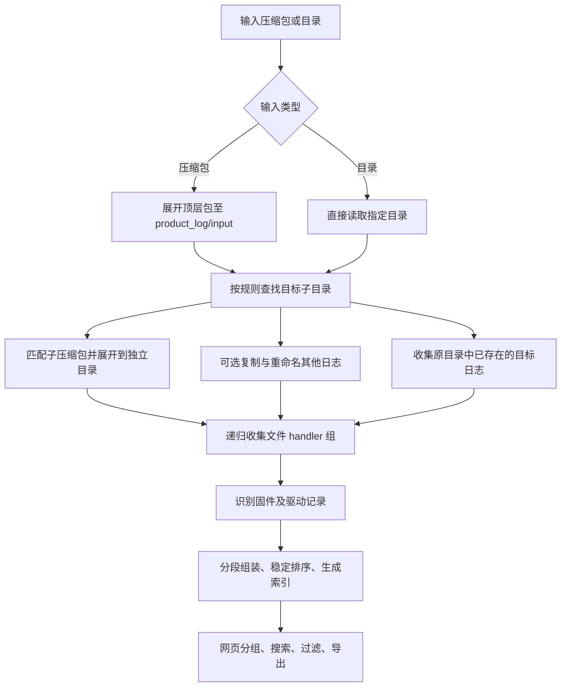
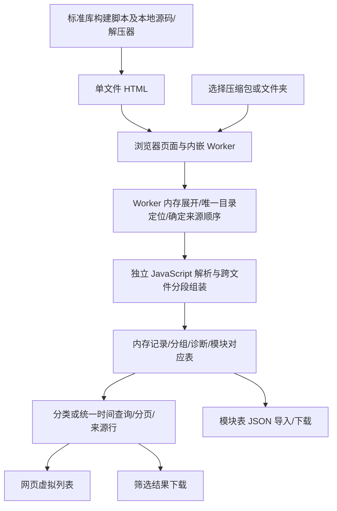

# 本地文件能力与产品日志解析设计书

日期：2026-10-11。状态：用户已授权编码；实现集中在 `product_log/`，用法与已实现边界见 [README](../product_log/README.md)。本文保留设计依据，验收结果见 [功能记录](../newFeature/2026-10-11-local-product-log-parser.md)。

第 1–11 节保留初版通用文件整理和日志解析设计；当前 diag/var 产品模式及后续确认以第 12 节为准，第 13 节说明单文件离线网页的数据流和边界。产品模式的业务文件顺序、驱动分类及模块映射覆盖初版相应约定，通用文件 SDK 和普通环境脚本接口不变。

本轮已确认：每个固件 seg 由一条带标准日期时间及 SlotId/CpuId/ModuleName/Unit/logType/seg 的驱动日志头开始，后续固件正文使用 `[87527.625]` 这样的内部计时格式；同一 seg 正文不会跨文件，但不同 seg 会跨文件，必须自动拼接；跨文件按文件名字典序和文件内行序组装。目标目录必须唯一，支持 `diag/slot62` 这样的部分路径，多命中报错；每任务独立工作目录，网页显示实际绝对路径。

## 1. 目标与现状

目标是把本地压缩包或目录整理成可遍历的文件 handler 组，自动识别固件、驱动日志，并在网页按实际解析出的维度筛选、搜索和阅读。通用文件操作、产品日志规则、网页使用同一套核心逻辑，脚本可独立运行。

当前实现核实结果：

| 现有能力 | 位置 | 本次处理方式 |
| --- | --- | --- |
| 精确文件引用 `get_file()`，不可变 `FileHandle`，创建时计算 SHA-256 | `autoenv/file_handles.py:26`、`:63` | 保持已有接口及完整性语义，新增组和方法 |
| 旧 TAR/ZIP 安全检查 | `autoenv/logs.py` | 旧合同保持；新增通用 `local_archives.py` 服务新 SDK |
| 包中指定目标提取 | `autoenv/extractor.py:64` | 保持原用途；其替换目标目录的语义不适合多包汇聚 |
| 批次 manifest、SQLite、来源文件/行号、查询与导出 | `autoenv/logs.py`、`autoenv/log_query.py` | 复用架构思路，产品日志使用独立 schema |
| 旧日志字段只有 Slot/Socket，时间到秒，按文件/行号排序 | `autoenv/logs.py:41`、`:83`、`:602` | 新领域使用 Cpu/Module/Dev/LogType、整数微秒和确定性时间排序 |
| 旧搜索分支会整组 `fetchall()` | `autoenv/log_query.py:167` | 新查询不能沿用此实现 |
| 原网页以脚本、环境注册为主；旧日志 API/CSS 保留 | `webPage/index.html`、`server.py`、`logs.css` | 已增加独立日志页面和有界虚拟滚动 |
| 现有上传为 JSON/base64，文件上限 48 MiB | `webPage/server.py:606` | 新增大文件流式上传 |

设计前公开 API 没有 `find`、`get_handler`、`unzip`、`move_to` 或 `rename`。本次以 `FileHandle` 实现用户所说的 handler，并导出新增接口。

继续使用唯一启动命令 `python -X utf8 startWeb.py` 和 `http://127.0.0.1:8765/`。

## 2. 通用文件接口

以下是新增接口。`recursive` 默认 `False`，只返回普通文件，不把目录包装成文件 handler。

```python
fuzz_search(path, pattern="", recursive=False) -> FileHandleGroup
accurate_search(path, pattern, recursive=False) -> FileHandle | None
get_handler(path, recursive=False) -> FileHandleGroup

handler.unzip(unzip_path) -> Path
handler.move_to(destination_dir) -> FileHandle
handler.rename(new_name) -> FileHandle
```

`FileHandleGroup` 是有序、可重复遍历的集合，支持 `len()`、索引及 `for`。所有结果统一按 `(filename, relative_path)` 升序，使用区分大小写的 Unicode 字典序；同名文件由相对路径决定顺序。保持普通字典序，例如 `log10` 在 `log2` 前，不自动改为自然数排序。

为了让批量搜索快速返回，组先固定排序后的路径列表，成员 handler 在首次取用时创建并缓存；不是每次遍历重建 handler。路径列表的快照不冻结文件内容，首次取用时检查存在性、文件类型并建立此时内容的完整性快照；后续校验仍沿用 handler 合同。已有 `get_file()` 的 SHA-256 语义不静默降级，首次枚举路径的速度与完整取用所有成员的速度分别测量。

相对路径继续按已有规则解释：脚本 session 内相对于项目 root_dir，独立调用时相对于当前工作目录。新增操作复用 `operation_scope`，记录输入、目的路径、格式/数量、耗时和错误，不强制独立调用先初始化 session。大文件完整性校验与流式解析的重复读取列入性能评估，不将惰性组宣称为免除全部文件 I/O。

### 2.1 搜索语义

这里的通配符采用文件名 glob 语义，而不是 grep 的正则表达式。

| 输入 | `fuzz_search` | `accurate_search` |
| --- | --- | --- |
| `"target"` | 文件名包含 `target`，返回全部 | 文件名恰好为 `target`，返回第一个 |
| `"target*"` | 通配符匹配完整文件名，返回全部 | 同样匹配，返回排序后第一个 |
| `"*.log"` | 全部匹配文件 | 排序后第一个匹配文件 |
| `""` | 等同 `"*"` | 等同 `"*"`，返回第一个文件 |
| 无命中 | 空组 | `None` |

支持 `*`、`?`、`[abc]`、`[!abc]`。匹配只针对 basename，不针对内容；pattern 不含路径分隔符，递归由参数控制。不支持正则、多模式的 `|` 或 brace expansion；多通配符由整理规则的列表表达并去除同一路径的重复命中。

默认匹配区分大小写，使不同平台结果一致；如确认需要，增加显式 `case_sensitive=False` 选项。无效输入路径、目录无权限、非法 pattern 属于错误，不能伪装成无命中。遍历不跟随目录符号链接或 Windows junction，避免离开输入树。

### 2.2 解压语义

- 根据内容检测格式，扩展名只作提示；有效压缩包即使后缀不标准也可识别。
- 已支持 ZIP、TAR、TAR.GZ/TGZ、单文件 GZ、TAR.BZ2、TAR.XZ。单文件 GZ 与 TAR.GZ 分别识别。
- `unzip_path` 是输出目录，保留包内相对目录结构，返回实际输出目录的绝对 `Path`。
- 单文件 GZ 输出名优先采用去掉 `.gz` 的源文件名；源文件名没有该后缀时使用确定的 `data` 名称，不信任 gzip header 中可能包含路径的原文件名。
- 输出目录须不存在或为空；非空目录报错。本流程为每个压缩包分配独立子目录，最后递归收集为一个 handler 组，避免同名文件覆盖。
- 在临时目录完成校验和写入，成功后发布；失败清理本次临时结果，不留下看似成功的半包。输入压缩包保持原样。
- 沿用目录穿越、绝对路径、链接、特殊文件、成员冲突和展开额度检查；增加每任务累计文件数、展开字节和嵌套深度预算。
- 加密包、损坏包、不支持的格式返回明确异常。`.run` 会执行程序，首版日志解压不纳入；RAR/7Z 也不默认引入外部程序。
- `unzip()` 只展开当前一层。是否继续展开子包由整理规则控制，第一版默认处理顶层输入包及目标目录中匹配的子包，不无限递归解压。

多个 handler 共用完全相同的非空 `unzip_path` 会冲突；建议循环时使用 `unzip_path / archive_id`，而不是多包覆盖同一目录。

### 2.3 复制与重命名

`move_to()` 按用户要求执行复制：源文件保留，参数是目的目录，成功返回目的文件的新 handler。名称虽为 move，文档、运行结果和测试都明确标记为 copy，不增加第二套不同语义。

`rename("new_name")` 真实重命名当前文件，`new_name` 仅接受文件名并包含期望的扩展名，返回新 handler。已有 handler 不原地修改；旧路径已失效，调用方应使用返回值。流程中只对复制到任务工作区的文件重命名，避免整理步骤更改输入目录原件。

目的同名文件默认 `FileExistsError`，不自动覆盖或擅自改名；源与目的相同视为调用错误。复制或重命名失败不返回假成功 handler。

## 3. 日志整理流程与脚本

把 `/product_log` 理解为每批任务内的逻辑目录。CLI 默认批次根为当前目录的 `runtime_path/product-log-<UUID>`，也可使用 `--output`；Web 批次根为 `webPage/.runtime/product-logs/batches/<batch_id>`。批次中的 `product_log/` 再区分 input/expanded/selected，具体布局以产品日志 README 为准。



新增 `find_subdir(root, partial_path, recursive=True) -> Path`，只查目录，返回唯一匹配目录的绝对路径。零命中报未找到，多命中报歧义并列出排序后的所有候选，不取第一个。用户描述的 `find_subdir(str)` 可作为脚本内绑定当前 input_root 的便捷调用。

- 单组件关键词如 `slot62` 按目录名包含关系搜索；含 glob 时按完整目录名匹配。
- 多组件部分路径如 `diag/slot62` 要求路径中连续出现这些完整组件；没有 glob 的组件精确相等。统一 `/` 和 `\\` 为分隔符，可在组件内用 `*` 等 glob。
- 返回最后组件对应的目录。`root/a/diag/slot62` 命中；`root/a/diag/slot62/logs` 不会把 logs 再列为一个命中；`undiag/slot620` 不匹配 `diag/slot62`。
- 不接受绝对 partial_path、UNC、任何盘符形式、NUL、`.`、`..` 或以 `**` 代替递归参数。目录匹配的组件范围是 root.name 和 root 内的相对组件，不包含 root 外的祖先；root 本身也可候选。root 就是 diag 时，diag/slot62 可命中其直属 slot62。`recursive=False` 只检查 root 和直属子目录，多组件不会绕过递归开关。

每个整理规则定位一个唯一目录；多组规则可以显式指定不同部分路径，避免以“全部处理”掩盖选错目录。

第一版每任务定位一个唯一目标目录，压缩包/日志/复制模式可各给多个。不把产品目录名固化进通用 handler；脚本若要处理多个独立目录，可多次调用并创建不同批次。

```python
from product_log import run_analysis

batch = run_analysis(
    input_path, batch_dir,
    directory_pattern="diag/slot62",
    archive_patterns=["*.tar.gz", "*.tgz", "*.zip", "*.gz"],
    file_patterns=["*.log", "*.txt"],
    recursive=True, workers=4,
    copy_patterns=["extra.txt"],
    rename_map={"extra.txt": "driver-extra.log"},
)
```

目录输入里已经存在的目标日志也必须收集，不能只解析刚解出的文件。解析任务是“选中的工作区文件 + 原目录中命中的日志文件”的去重并集；无需复制整棵输入目录。原文件被复制为工作区文件时，按复制来源映射选择工作区副本，避免同一份日志处理两遍；独立路径下原本就存在的重复内容不受此规则影响。

`fuzz_search(target_path, "", True)` 命中所有文件，不代表所有文件都可以解压。`search_archives` 在搜索后检测实际压缩类型；空压缩包 pattern 时处理所有支持的压缩包，普通文件跳过并计数。指定非空 pattern 时先按文件名筛选，再校验格式。

每个规则命中目录、压缩包、文件数量均保存到 manifest。嵌套命中父子目录时，压缩包及文件按规范化路径去重，同一文件只解析一次；内容相同但路径不同的文件默认均保留。合并多个来源组时，同名同相对路径再以稳定来源 ID 打破平局。

目录布局为 `product_log/input`（顶层包内容）、`product_log/expanded`（子包）、`product_log/selected`（复制/重命名结果）。目录输入保留外部原目录。目标目录搜索排除 generated 子树和解析索引/临时文件；若 input_root 是外部目录且包含 work_dir，则排除整个 work_dir。顶层包输入时仍必须扫描 `product_log/input`，不能排除整棵 product_log 而漏掉输入。最终解析从登记的候选文件取并集，不把未命中规则或生成的数据库当作日志。

## 4. 统一记录模型

新领域模块独立于旧远程采集规则，不把 `CpuId` 填入旧 `socket_id`。

| 对象 | 主要字段 |
| --- | --- |
| 来源 | source_id、导入批次、原始相对路径、压缩包成员路径、设备来源标识（如可提取） |
| 驱动记录 | read_time 原文/排序值、slot_id、cpu_id、module_name、info_text、raw_text、source_id、line_number |
| 固件分段 | slot/cpu/module/device/log_type/seg、段头 read_time、host/service、正文及来源范围；每段来自一个文件 |
| 固件读取批次 | dump_id、stream_key、anchor_time、first_read_time、分段集合、异常标记 |
| 固件正文行 | dump_id、segment_id、段内行序、segment_read_time、firmware_time 原文/可选数值、正文原文、来源行号 |

驱动记录及固件 seg 头部都使用标准日期时间，保留 `.383` 等小数位，规范化为整数微秒排序值，避免浮点误差。固件正文继承其所属 seg 头部的读取时间。设备日志没有时区信息时保持设备本地时间语义，不假定它等于服务器北京时间，也不自动校时。缺少或损坏段头时间属于异常输入诊断，不扩展为另一种无日期头格式。

固件内部 `[87527.625]` 暂视为固件计时值，保留原文；若确认单位为秒则保存整数微秒辅助筛选。不能仅凭该值推导真实发生日期，也不能跨设备直接比较 uptime。

必需字段缺失的记录保留在未分类集合并统计原因，不让异常字段串入正常分组。原始来源始终保留，简洁视图不改变索引内容。

## 5. 固件解析与分段组装

### 5.1 先识别分段，再识别正文

每个固件 seg 从用户示例的标准驱动日志头开始。先识别 `2000-01-06 03:51:36.383 ...` 外层记录，并通过 `Unit[...] firmware logType[...] seg[...]` 判为固件段头；提取读取时间、SlotId、CpuId、ModuleName、Unit、logType、seg。其后 `[87527.625][0-0][IMP-EVENT] ...` 是固件正文，不要求正文也匹配标准日期头，不会被误判为缺时间记录。字段容忍空格及 `Info/info` 的大小写差异，不用一条贪婪跨行正则吞整个文件。

固件头之后的内容持续到下一条完整标准外层驱动日志头或 EOF，下一条头部可以属于固件或普通驱动记录。正文中的 `[uptime]`、空行或单独出现的日期字符串不是结束标记。记录边界识别与分类字段提取分开：一条结构有效但缺 SlotId/CpuId 等字段的新日志也必须结束当前分段，并进入未分类，不能吞入前一固件正文。正文若与 header 同行，冒号之后的内容同样保留；尾部括号只在能够确认属于外层包装时移除，不使用 `strip(")")` 破坏正文。无固件计时前缀的延续行也保留。用户确认每个 seg 正文完整位于一个文件，因此 EOF 结束该段，但不结束可能跨文件的读取批次。

驱动与固件可以出现在同一文件中。先识别固件专有头，避免把固件 header 当作普通驱动日志。无法识别的外层记录和孤立正文保存到未分类来源范围。

### 5.2 批次组装规则

推荐内部 `stream_key = (来源设备/逻辑流, host, service, slot_id, cpu_id, module_name, device_id, log_type)`；目录来源信息用于避免不同设备的相同 Slot 编号被错误拼接，不把每个源文件路径永久当成设备 ID。

逻辑来源以规则定位的唯一目标目录/已声明设备来源为边界，使不同文件、不同子包中属于同一设备的 seg 可以汇聚。正文直接继承本段头的身份与读取时间，不跨段、跨文件随意继承元数据。段头必需字段损坏或缺失时保存未分类/异常诊断，不把全部 unknown 合并为同一流。

1. 在分派任务前固定文件排序 `(filename, relative_path)` 和 source_rank；每个文件 worker 只输出完整 Segment，保留段头和正文行号。
2. 合并器严格按 `(source_rank, header_line)` 消费段头。按用户确认的文件名字典序、文件内行序判断归属，不按 worker 完成时间、文件 mtime 或段头时间重排批次归属。
3. 对每个 stream_key 维护当前 dump。同流 seg=0 开启新读取；非零 seg 接入该流当前 dump。不同流允许 `A seg[0] -> B seg[0] -> A seg[1]` 交错，不互相关闭。
4. 文件 EOF 只结束该文件中的 Segment，不关闭逻辑 dump，所以前一文件的 seg=0 可接上后一文件的 seg=1。任务输入全部消费完或同流出现下一次 seg=0 时，完成此前 dump。
5. 遇到非零 seg 且没有当前 dump 时建立缺少起始段的部分 dump，后续非零段继续加入；之后遇到 seg=0 开始新的正常读取，不把之前的孤立段倒接进去。
6. 每个 dump 最后按 seg 数值、同号分段的来源顺序、段内行序拼接。重复非零 seg 和重复正文保留；重复 seg=0 默认表示新读取，不擅自去重。
7. `0, 2` 标记缺少中间段 `1`；没有总段数/结束标记时无法证明最后一段是否缺失。多个 seg 跨文件是正常输入，不标为截断。

段的来源关系仍保存到文件及行号，跨文件拼接不修改原始文件。若同流确实会并发读取且无额外标志，这属于格式本身信息不足，需要在真实样例中确认可用的消歧信息。

示例中 `seg[0]` 与 `seg[1]` 的相同正文是两份原始证据，拼接后六条均保留，不擅自去重。多次 dump 内容重叠也默认保留。

### 5.3 时间排序与拼接视图

固件有段头的“读取时间”和正文的“固件计时”两条轴。正文使用所在 seg 段头的读取时间输出。完整分段拼接与严格逐行读取时间排序即使在正常的交叠读取中也不能同时保证；文件名字典序确定批次归属，展示时排序是独立步骤。

**实现默认：严格读取时间升序。** 按 `(segment_read_time, source_rank, line_number)` 稳定排序，满足用户从早到晚的要求。另提供完整拼接视图：dump 按 anchor 时间排序，批次内部按 seg/段内原序。每行前缀始终显示其来源分段的真实读取时间，不改写为 seg[0] 时间。

正常输入中每个 seg 都有段头读取时间，正文前缀直接来自该段头。异常段头无法提取时间时保存诊断和来源，不填服务器时间、文件 mtime 或其他段日期，也无需用户选择一种无日期固件格式。

完整拼接视图只保证 dump anchor 升序和各 dump 的 seg 顺序。不同 dump 读取区间重叠时，例如 A=(10,12)、B=(11,13)，拼接输出 10,12,11,13；默认时间视图输出 10,11,12,13，可能打散完整 dump。批次归属仍在排序前按文件/行序确定。

如果用户希望固件正文按 `[87527.625]` 排序，需要先确认单位、是否重启归零、是否多核独立计时及环形缓冲区顺序。当前建议保留段内原序，不擅自做这种重排。

目标固件显示：

```text
[2000-01-06 03:51:36.383][87527.625][0-0][IMP-EVENT] some message
[2000-01-06 03:51:36.383][87527.625][0-0][IMP-EVENT] some message2
[2000-01-06 03:51:36.383][87528.435][0-1][IMP-EVENT] some message3
[2000-01-06 03:51:36.383][87527.625][0-0][IMP-EVENT] some message
[2000-01-06 03:51:36.383][87527.625][0-0][IMP-EVENT] some message2
[2000-01-06 03:51:36.383][87528.435][0-1][IMP-EVENT] some message3
```

普通筛选分组使用用户要求的 `(slot_id, cpu_id, device_id, log_type)`。ModuleName 仍保存并作为附加筛选；如这四项下存在多个 ModuleName 或设备来源，页面提示来源数，允许进一步选择，不能声称四项始终唯一。

## 6. 驱动解析与两种显示模式

每条外层记录提取 read_time、SlotId、CpuId、ModuleName 和 `Info=` 后正文。默认单行；若真实日志存在跨行 Info，可以沿用外层 header 状态机扩展。

分组键为 `(slot_id, cpu_id, module_name)`，设备来源作为附加维度保存。排序按 `(read_time, source_rank, line_number)`，使用整数微秒；并行 worker 的完成顺序不参与排序。ModuleName 由逗号或外层右括号界定，保留 `udk log` 等名称内部空格并去除字段两端空白。

简洁模式建议保留 `<28028:28041>`，输出：

```text
2000-01-06 03:51:36.383 Info=<28028:28041> 日志内容
```

原本模式显示完整原文，包括 hostname、模块标识、Service、SlotId/CpuId/ModuleName 和外层包装。切换模式只切换渲染，不重新解析。不完整的 Info 也保留原文并标记解析告警。

搜索默认针对解析出的正文/Info，切换简洁或原本模式不改变结果；提供“搜索完整原文”选项，便于查找外层字段。

## 7. 并行、索引与性能

按文件分配 worker，单个文件顺序、流式解码。驱动和固件共享同一遍解析，不为每个下拉分块重读文件。不按任意字节切大文件，避免断开固件正文和编码字符。

实现使用有上限的线程池，每文件写独立 SQLite 分片；少量文件顺序运行。CLI 默认 4 个 worker，可指定 1..32；网页限制 1..8。单个巨大文件的第一版不承诺线性并行加速，CPU 受限时后续根据基线评估进程池。

worker 分批写任务内临时分片。合并器先按用户确认的文件名字典序和文件内段头行序恢复来源顺序，再执行第 5.2 节 seg=0 开新批次、非零段接当前批次的规则；文件 EOF 不重置跨文件活动 dump。最后按 seg 和 anchor 排展示顺序，不能先按段号或日期排序再判断批次归属。通过 SQLite 排序/索引建立最终序列，不把所有记录存为 Python 列表，不让多进程抢写同一个 SQLite。大 dump 的正文也落盘，以元数据和引用组装。

最终数据库包含 `sources / records / segments / dumps / groups / diagnostics`。records 区分驱动/固件/未分类。驱动索引覆盖 `(slot, cpu, module, time)`；固件索引覆盖四项分组、dump 顺序及读取时间。来源顺序在任务分派前固定，相同输入多次解析顺序相同；来源 ID 使用结构化 provenance_parts，`!/` 只用于展示。

结构和时间过滤由 SQL 在分页前执行，单次最多返回 500 条。关键字按字面子串查找，默认不引入正则。`instr()`/参数化 LIKE 可保证内存有界，但短关键词或任意子串仍可能扫描当前分组，不能把结构索引说成全文索引。

第一版采用服务端扫描、同条件命中结果缓存和取消机制，防止每个滚动窗口重复扫描全部正文。命中缓存只保存有序记录 ID，采用落盘结果集和容量/失效限制，不另建无限增长的内存列表。如果真实规模需要更快搜索，验证运行时 SQLite 的 FTS5 trigram 能力后再添加候选索引，且必须验证中文及子串语义，不用普通分词查询代替子串查询。

前端输入去抖，取消过期查询；只创建可视窗口及少量预加载行的 DOM。模式切换、分页、筛选不重新解析原文件。

第一版先尝试 BOM/UTF-8，失败后尝试 GB18030；流式读取并记录实际编码。无法解码的字节保留来源并记录替代文本诊断，不静默忽略整行；含 NUL 的二进制输入保存诊断，不作为支持的文本日志。

manifest 记录展开文件数、字节数、整体耗时及告警；阶段事件记录进度。峰值内存、真实样本搜索 P95 是后续性能验收指标，当前不宣称已测量，也不承诺未经测量的秒数。

## 8. 网页与任务契约

新增 `/product-logs/`，由现有页面提供链接，仍由唯一 server 提供服务。用户要求特殊功能独立目录，因此 `product_log/` 提供自己的模块 CLI；Web 专属任务线程调用同一 workflow，负责导入、规则、事件和查询，不复制业务解析逻辑，也不要求绑定远端环境。

### 8.1 输入

- 拖入或选择压缩包：通过新流式上传接口写入受控任务目录，不使用整文件 base64。对于大包可分块上传，单块有上限，支持取消和校验完成后发布。
- 输入本机目录绝对路径：由运行现有服务的电脑直接读取，只读导入；输出放到任务工作区。
- 浏览器选择目录：获得相对路径及文件内容，保持相对层级上传。不能依赖标准 file input 提供一个服务器可直接读取的原始绝对目录路径。

HTTP 上传使用 upload_id，查询使用 batch_id/source_id；只在显式本机路径导入接口接收输入路径。输出、导出和原文定位限制在任务已登记的路径集合内。大包上传不是借用普通 local Web Tool 绕过其限制。

### 8.2 A/B 流程反馈

页面显示输入类型和名称、实际输入根目录、实际 product_log 绝对目录、各规则命中目录/压缩包/日志文件数量、展开和解析进度、耗时、告警摘要。用户可以查看匹配明细，确认是否整理到了预期日志。

状态：`uploading -> preparing -> extracting -> collecting -> parsing -> indexing -> ready`；异常为 `failed`，用户停止为 `cancelled`。只有 ready 的数据库对浏览接口发布；有解析告警但流程可完成时，ready 携带告警数量。压缩包损坏或额度超限默认令任务失败，避免将不完整导入当作成功。

解析任务与现有环境脚本任务分开跟踪，不能用现有 `ProcessSession.start()` 的“停止上个任务”行为启动新日志任务。日志解析同时运行一个任务，重复启动明确提示等待；一个任务内部仍可多文件并行。重新导入创建新 batch_id，不覆盖前次结果。Web 受管 uploads/batches 达到 3 GiB 后回收最旧的可清理历史，保留当前任务、正在浏览和最新结果及引用输入；这是回收触发阈值而非硬配额。CLI 输出和外部原件不参与自动删除，精确规则以产品日志 README 为准。

### 8.3 浏览

固件 / 驱动切换后，下拉框仅给出数据库中实际出现的分块，显示记录数；支持组合分块下拉与联动字段筛选。

- 固件：SlotId -> CpuId -> DevId -> LogType，附加 ModuleName。
- 驱动：SlotId -> CpuId -> ModuleName。设备来源、dump ID 在记录中保留，独立下拉筛选属于后续扩展。
- 内容过滤、搜索命中高亮、读取时间范围、清空筛选、未分类/告警入口。
- 驱动简洁/原本模式；固件默认严格读取时间排序，可切完整拼接模式。
- 连续虚拟滚动、命中上下文、查看来源文件和行号。过滤命中与上下文行区别显示，上下文不是额外命中。
- 建议附加导出当前筛选结果：固件合成格式、驱动当前显示格式，以及来源原文；不必预生成所有组合文件。

拟新增 HTTP 接口，命名可在实现时与现有风格统一：

| 接口 | 用途 |
| --- | --- |
| `POST /api/product-logs/uploads/create`、`chunk`、`finish` | 创建、写入、完成上传（准确路径以 web.py 为准） |
| `POST /api/product-logs/start` | 传 upload_id 或本机目录、规则，启动任务 |
| `GET /api/product-logs/events` | 按 task_id/cursor 返回进度和完成结果 |
| `POST /api/product-logs/stop` | 停止指定任务 |
| `GET /api/product-logs/batches` | 已完成批次及统计 |
| `GET /api/product-logs/groups` | 当前批次真实分组及联动选项 |
| `GET /api/product-logs/query` | 分类、时间、关键词、模式、窗口查询 |
| `GET /api/product-logs/source`、`export` | 已登记来源定位及流式导出 |

## 9. 实施拆分与验收

实施顺序：通用文件 API/安全解压 -> 规则驱动的本地整理脚本 -> 固件/驱动解析与索引 -> 导入及浏览页面 -> 真实日志验收。每阶段都可离线验证，不需要访问设备。

已采用 `autoenv/local_archives.py` 和文件 API 公共导出；特殊功能独立为 `product_log/{workflow,parser,index,web,__main__}.py` 及 `static/`。保留现有远程日志采集和查询契约，不在 scripts/ 添加第二套解析逻辑。

实现时同步脚本 API 目录、生成脚本 skill、README/快速开始/详细设计/测试说明，并添加当日 `newFeature` 记录。创建脚本前按项目要求加载 autoenv-script-generator；改变 Web bridge 前依据现有架构说明执行相关契约检查。

验收重点：

1. 搜索递归开关、关键词与通配符区别、空结果、大小写、同名路径和稳定字典序。
2. ZIP/TAR/GZ、错后缀、损坏包、同名成员、输出冲突、路径穿越、链接、特殊文件和展开额度。
3. move_to 确认是复制，源保留、新 handler 路径正确；rename 后使用新 handler、冲突不覆盖。
4. 顶层压缩包/目录两种输入，父子目录重复命中、已有裸日志、多规则并集及输出树排除。
5. 标准驱动格式 seg 头的字段提取；内部计时正文继承所属段头日期；seg=0/1 跨文件拼接、worker 完成乱序；同内容不去重；多个流交错、多 dump、缺段、重复段、EOF 和孤立正文。
6. 1..6 位日期小数、微秒排序/过滤、跨日、时间相同、来源文件名与日志时间相反、worker 完成乱序、分段时间倒退和损坏时间。
7. 损坏时间保留原始来源并进入未分类/诊断，不给正常固件正文推算时间；时间范围查询不将未知记录当作命中。
8. 驱动简洁/原本模式、Info 内部括号、关键字作用域、未分类和编码问题。
9. 网页真实下拉分组、全组搜索后分页、模式切换不重解析、DOM 有界、取消、队列和批次隔离。
10. 聚焦 UT、脚本静态发现/生成合同、Python 编译、JS 语法、相关 skill 校验和完整离线回归；浏览器操作验收与大样本压测另记录。

本次构造真实压缩包、多文件日志及 loopback HTTP/CLI 测试；实际执行结果统一记录到功能记录。真实产品样本和规模性能属于后续验收。

## 10. 已确认与第一版默认值

| 编号 | 需要确认 | 推荐默认值/影响 |
| --- | --- | --- |
| C1 | 实际目录部分路径、压缩包与日志文件模式 | 已确认多命中报错；支持 diag/slot62 逐组件匹配唯一目录，具体产品规则待给出 |
| C2 | product_log 路径与平铺 | 已确认每任务独立目录、网页显示绝对路径；每包独立目录是推荐布局 |
| C3 | 固件时间排序 | 遵循用户原始要求：默认严格读取时间升序；可选完整拼接视图；内部计时保留原序 |
| C4 | 跨文件读取先后与批次识别 | 已确认多个 seg 跨文件、一个 seg 不跨文件；按文件名字典序和文件内顺序自动组装 |
| C5 | 固件四项是否在多个 Module/设备间唯一 | Module/设备来源始终保存，附加筛选避免误合并 |
| C6 | 文件名大小写、空关键词、准确搜索的首个结果 | 区分大小写；空等于 *；第一个指统一排序后的第一个 |
| C7 | 驱动简洁模式是否保留 `<28028:28041>` | 保留，输出 `时间 Info=<...> 正文` |
| C8 | 通常/最大输入规模和编码 | 用户明确当前为本地工具，不开展额外大文件优化；真实日志可直接在本地验证，不要求脱敏作为前置 |
| C9 | 单文件 GZ、TAR.BZ2/XZ、RAR/7Z 的实际需求 | 已支持 ZIP/TAR/TAR.GZ/TGZ/GZ/BZ2/XZ；RAR/7Z 不支持 |
| C10 | 固件段头与正文格式 | 已确认段头是带标准日期的驱动日志；正文以内部计时开头，继承本段头读取时间 |

C4/C10 已明确，无需再次确认。C1 以 CLI/网页规则输入实现，不硬编码未知产品目录；C8 的额外性能优化不在当前范围。依据用户本轮取舍，只增加产品日志 3 GiB 阈值回收及文档整理，Web 来源保护、配置并发事务、脚本生命周期改造与主机身份校验保持现有策略。使用规则以 [product_log/README.md](../product_log/README.md) 为权威，通用 SDK 完整接口以 [SCRIPT_API_ANALYSIS.md](SCRIPT_API_ANALYSIS.md) 为权威。

## 11. 外部接口依据

- [Python 3.11 fnmatch 文档](https://docs.python.org/3.11/library/fnmatch.html)：支持文件名 glob；本设计显式指定匹配大小写语义。
- [Python 3.11 tarfile 文档](https://docs.python.org/3.11/library/tarfile.html)：TAR 可透明检测压缩格式；解压必须进行成员校验及失败清理，不能只依赖扩展名。
- [Python 3.11 multiprocessing 文档](https://docs.python.org/3.11/library/multiprocessing.html)：Windows spawn 要求 worker 可导入，入口导入不能重启业务流程。
- [SQLite FTS5 文档](https://www.sqlite.org/fts5.html)：trigram 可支持子串候选索引，短于三个字符的全文匹配存在限制，需保留字面子串验证。
- [MDN 目录选择](https://developer.mozilla.org/en-US/docs/Web/API/HTMLInputElement/webkitdirectory)、[文件选择](https://developer.mozilla.org/en-US/docs/Web/HTML/Reference/Elements/input/file)：目录选择提供 File 和相对路径；本机绝对目录导入需要独立服务器端入口。

## 12. diag 用户态、var 内核态与模块映射：已确认实现

状态：2026-10-11，用户已确认，collection/parser/index/模块表/网页及共享 CLI 已实现。当前操作说明见 [product_log README](../product_log/README.md)。此前固件正文/分段确认、独立任务目录及 3 GiB 清理规则继续适用。

### 12.1 输入与来源顺序

顶层压缩包/目录处理及 diag 原有解压流程保持。产品模式默认在输入根内递归定位精确名为 `diag`、`var` 的目录；`var` 指输入中的目录，不是本机操作系统的根目录。多个候选继续报错，允许分别提供部分路径消歧，例如 `diag/slot62`。只存在其中一类时仍解析可用日志，另一类没有记录；显式产品模式两类目标都不存在时报错。两个目录规则不能指向同一个目录；其中一类目标嵌套在另一类内时，子树只归属其明确选定的日志域，不重复展开或解析。

| 收集模式 | 规则 |
| --- | --- |
| `auto` | CLI 默认。发现任一产品目标后采用产品规则；未发现则回退初版通用规则。显式旧 `directory_pattern/--directory` 继续采用通用选择 |
| `product` | 网页使用；CLI 可显式指定。分别定位 diag/var，至少一类存在，采用以下业务来源顺序 |
| `generic` | 显式保留初版任意目录、文件模式和一轮子包展开，handler/来源文件按通用字典序处理 |

CLI 提供 `--collection-mode`、`--diag-directory` 和 `--var-directory`；共享函数对应 `collection_mode`、`diag_directory_pattern`、`var_directory_pattern`。产品文件/压缩包模式只限制 diag，var 始终递归发现全部压缩包和标准 dmesg 文件。`--no-recursive` 限制 diag/通用搜索，var 仍递归。

| 来源 | 目标文件 | 解析/组装来源顺序 |
| --- | --- | --- |
| diag | `diaglog_*.log`、`diag.log` | 历史文件名字典序升序，`diag.log` 最后；文件内保持原行序 |
| var | `cpdt_dmesg_current.log.<数字>`、`cpdt_dmesg_current.log` | 按用户指定的数字升序 `.1,.2,...,.10,...,.n`，无后缀 current 最后；文件内保持原行序 |

同名文件用相对路径稳定消歧，并保留完整来源。不同父目录的内核轮转文件分别保留其来源链。上述是产品日志的业务来源顺序，不改变 SDK handler 组通用的文件名字典序合同。最终时间视图按解析日期排序；来源顺序用于固件段关联及同时间记录的稳定顺序，不能用文件排序替代时间排序。

仅 var 新增多层展开：递归发现受支持压缩包，展开后继续寻找下一层，直到无待展开压缩包。复用现有解压 SDK、每包独立输出目录、累计展开计量与取消机制；每个压缩包来源处理一次，保留完整嵌套来源，不修改用户原件。不能沿用默认 `*.log` 选择内核文件，否则会漏掉 `.log.1` 等轮转文件。

### 12.2 分类与名称

diag 中原有驱动记录明确标记为“用户态日志”，var 中 dmesg 记录标记为“内核态日志”；两者均属于驱动日志。驱动页面增加“全部 / 用户态 / 内核态”下拉框，记录保留来源标签。固件继续单独分类，不因其段头使用驱动格式而重复计入用户态记录。

用户态先解析所有真实记录，按 `(SlotId, CpuId, 规范化 ModuleName)` 自动建立实际出现的分组，下拉框提供实际字段及组合。ModuleName 解析后按字段值精确匹配。唯一名称归一例外为 `udk` 及 `udk` 后接空白的后缀名称，例如 `udk log`、`udk upgrade`，不区分大小写统一作为 `udk`；`udk2` 等名称不归入。原始 ModuleName 和完整原文仍保留，其他模块不按前缀合并；固件打印组件的 ModuleName 保持原值，不应用用户态名称归一。

固件仍按 `(SlotId, CpuId, Unit/DevId, logType)` 分类，seg 拼接遵循新的 diag 来源顺序，正文日期继续取所属 seg 的段头读取日期。固件类型显示名为 `0→bios`、`1→IMP`、`2→IMU`、`3→HSM`，其他值直接显示数字；数值 logType 始终保留，名称只改变展示。

### 12.3 模块表与内核匹配

网页提供可编辑表格，列为“模块 / 用户态 ModuleName / 内核态关键词”，预置：

| 模块 | 用户态 ModuleName | 内核态关键词 |
| --- | --- | --- |
| udk | udk | udk |
| UBE | UBE | mami |

用户态解析后把其他发现的 ModuleName 补为可编辑行，默认内核关键词留空并标记“未配置”。表中指定的用户态名称没有匹配时标记“不存在”，保留该行及其内核查询能力；“不存在”与“未配置”含义不同。初始默认/发现表按已解析数据提供，用户保存后写入该批次 `module-map.json`，重新打开批次恢复；不同批次保留各自配置。删除发现行但仍未映射该用户名时，查询表会再次自动补入。

选择模块后，用户态使用该行的规范化 ModuleName 精确筛选，内核使用该行的关键词在整条原始日志上做不区分大小写的字面子串匹配。模块表已提供关键词，不增加重复的独立内核关键词输入框；通用内容搜索继续作为附加条件。

内核文件中的非空行先解析日期并建立索引，选择模块或保存映射时即时查询，避免重新解压/解析。关键词匹配不是正则表达式；不要求内核行包含 `ModuleName=`。同一内核行可以命中多个模块，单模块视图分别可见，全部/统一视图按原始来源记录只显示一次；不同来源的重复正文仍保留。

固件类型与驱动模块分别管理，不根据 `udk→udk→udk` 等表格擅自给固件推导模块归属。

### 12.4 日期和显示

支持用户提供的内核日期格式：`[Thu Jan 6 04:36:49 2000] <LpoThread_u10_p:25170:28546> [日志主体]`。显式解析英文月份和年月日时分秒，标准化为 `2000-01-06 04:36:49`；沿用现有设备本地日期和整数微秒排序，原始秒精度不推算出更细精度。保留线程/进程标识及原文。驱动用户态的简洁/原本模式继续适用；内核简洁模式展示标准化日期与线程/正文，原本模式保留完整原行。

用户态日期、固件段头读取日期、内核日期共享时间范围筛选。固件内部 uptime 保持正文，不拿它替代段头日期。日期相同时用来源顺序/行号稳定排序。每条无可解析日期的内核行都标记 `[时间未知]`，绝不继承上一行、同文件或其他文件的日期；在不限制时间的视图排到有日期记录之后，有日期范围筛选时不把未知日期当作命中。开启命中上下文可附加相邻未知行，其 `is_context=true`，不计入命中数量。

新增统一时间视图合并三类记录，严格按真实日期升序，同时保留原分类和固件拼接视图。对应表业务模块只约束两态驱动，不推导固件模块归属；Slot/Cpu 仅约束用户态与固件，Dev/logType 只约束固件，原 ModuleName 条件精确筛用户态名称和固件打印组件，内核忽略这些设备/组件条件。内核 Slot/Cpu 显示未知并保留来源路径。统一视图的原本模式仅还原驱动原文，固件保留段头读取日期前缀。

### 12.5 用户确认与接口验收

| 编号 | 问题 | 已确认并实现 |
| --- | --- | --- |
| C11 | 内核示例没有 SlotId/CpuId，设备归属从何而来？ | 内核只按模块筛选，Slot/Cpu 显示未知，并保留来源路径，不从关键词或线程名推断设备 |
| C12 | “日期一同解析”是否要求三类记录放入同一列表？ | 增加统一时间视图，同时保留分类视图；各类按自身条件取记录，再按日期合并 |
| C13 | 内核文件中的无日期行如何处理？ | 全部标记时间未知，不继承日期；即使前一行已有有效日期也不继承 |

查询/导出支持 `kind="all"`、`driver_domain="user"/"kernel"` 和表中业务名 `module`，原 ModuleName 查询参数保留；`list_groups` 支持驱动来源，并为固件附加 `log_type_name`。`list_module_mappings/save_module_mappings` 及 `GET/POST /api/product-logs/modules` 返回表格与用户存在状态、用户/内核记录数、内核是否配置。内核分组依赖当前映射动态生成，改表不修改原始索引。索引版本已升为 **2**，继续使用整数微秒，旧版本批次明确要求重新导入。

离线验收使用 `test_product_log_collection.py`、`test_product_log_domains.py` 和真实 HTTP/CLI 测试，覆盖 diag 历史+current、`.1/.2/.10/current`、多层混合压缩包、多 Slot/Cpu/模块、UDK 后缀与 udk2 排除、固件 0/1/2/3/其他类型、大小写内核匹配、缺日期、不存在映射、改表即时查询及跨类型日期排序；继续验证原件保留、来源查看和现有回收功能。

`tests/product_log_domain_sample.py` 生成可复现 diag/var 演示包；预期 **11 文件、2,003 用户态、408 内核态（8 条时间未知）、3,600 固件、统一视图 6,011 条**。UDK 用户态为 500 条、内核匹配 104 条，UBE 的 mami 内核匹配 100 条。命令、未压缩源文件位置和旧通用样本见 [产品日志测试说明](../product_log/README.md#测试)，实际测试结果与浏览器证据记录在本功能现有 [变更记录](../newFeature/2026-10-11-local-product-log-parser.md)。

## 13. 单文件离线日志网页

独立页由源码中的 `product_log/standalone/` 和 `tools/build_product_log_page.py` 构建。命令为 `python -X utf8 tools/build_product_log_page.py`，默认产物 `dist/product-log-offline.html`；也支持 `python -I -S -X utf8 tools/build_product_log_page.py`。构建仅用 Python 标准库，读取本地解压器资源并核对哈希，将页面、样式、主线程脚本、Worker 及解压器全部内嵌。使用者拿到一个 HTML 后仅需现代桌面浏览器，运行不依赖 Python、Node、联网下载或本地服务。具体操作及格式范围以 [独立离线页说明](../product_log/standalone/README.md) 为准。

### 13.1 数据流与职责



`archive.js` 负责格式识别、内存解压、目录选择、diag 一层/var 多层展开与业务文件排序；`parser.js` 接收有序来源数组，解析用户态/固件/内核，组装跨文件 seg，提供分组、模块表、查询、来源及导出；`worker.js` 连接消息请求与核心，`app.js` 管理输入、进度、表格和日志阅读。解压器随源码保存并内嵌，第三方许可随 HTML 保留。

浏览器版本使用独立 JavaScript 实现，以真实样本与 Python 生产结果对照保持第 12 节的业务语义。构建不直接打包执行原 Python，也不导入 `autoenv` 或服务模块；原 SDK、CLI、HTTP 服务、`product_log/static/` 及 wheel 入口保持原有代码与行为。日期排序使用精确整数微秒；普通设备日期保存为 JavaScript 安全整数，超出安全范围时保存十进制字符串并通过 BigInt 比较。

### 13.2 内存与来源边界

浏览器只处理用户通过文件/目录选择授予的内容，显示相对目录、压缩包来源链和行号；它不能根据输入文字读取任意绝对路径，也不生成磁盘解压目录、SQLite 索引或历史批次。日志、分组和模块表只存当前页面内存，刷新/关闭后重新导入；模块表可以下载 JSON 并在下次解析后导入。可选复制/重命名作用于内存副本，保留原文件及读取顺序。

3 GiB 自动清理继续只管理原服务端 Web 的上传和历史批次。离线页不管理磁盘历史，浏览器内存占用也不按该阈值自动清理。日志下载使用浏览器保存机制，输出位置由浏览器和使用者选择。

### 13.3 验收及未覆盖项

测试实际运行浏览器 JavaScript，并从生成的单文件 HTML 取出真实内嵌 Worker，在禁止网络的 Node 环境执行读取、嵌套解压、解析、分类、查询及导出；与 Python 生产实现对照 **11 文件、2,003 用户态、408 内核态、3,600 固件、统一视图 6,011 条**。Node 是开发验证工具，不属于交付文件的运行依赖。

当前内置浏览器禁止 `file://`，没有新增临时服务器或替换 URL 绕过限制，因此真实桌面双击打开及网页视觉/操作验收尚未完成。测试不能代替实际浏览器版本、文件/目录选择和真实设备格式变体的验收；已运行检查与后续使用注意事项见 [独立离线页说明](../product_log/standalone/README.md) 和功能记录。
