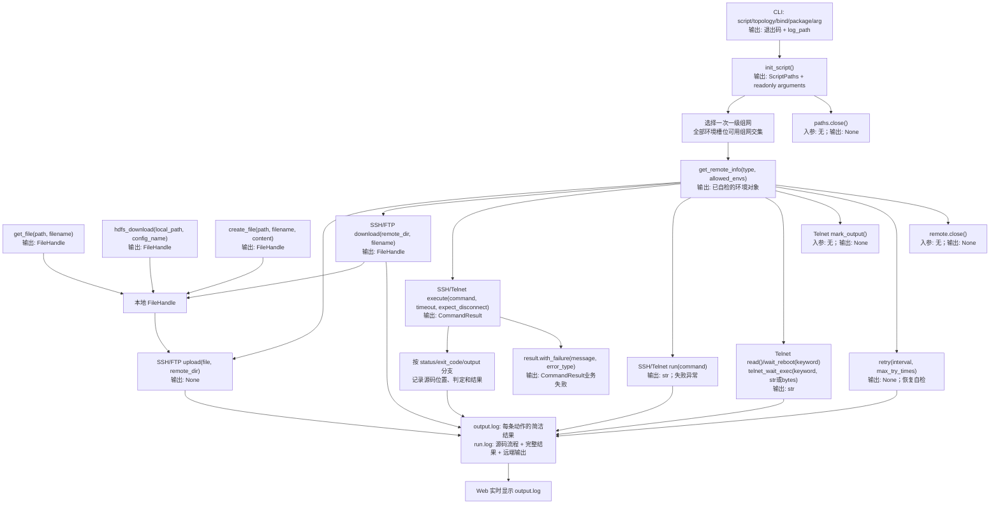

# AutoEnv 四类接口重构计划与第一版实施约定

创建：2026-10-09；修订：2026-10-10。本文归档全部接口讨论；以本文的新设计为准。连接、命令 framing、SCP/SFTP/FTP 字节传输和 HDFS 选择/下载路径继续复用已验证的实现，修改调用层和运行宿主。第一版验证结果单独记录在 [LOCAL_SIMULATION.md](LOCAL_SIMULATION.md) 与本次 newFeature 记录，不能把计划中的目标当作已完成的真实设备验收。

## 最简实现：普通 Python 文件就是脚本

后续本地文件扩展与独立产品日志已归档到 [产品日志说明](../product_log/README.md) 和 [2026-10-11 功能记录](../newFeature/2026-10-11-local-product-log-parser.md)。原环境脚本宿主与协议规则继续适用；产品日志拥有独立模块 CLI 和同服务网页。

`scripts/example.py` 是最小完整示例；不需要 `@register_script`、ctx、文件选择器、资源标签或上传占位符。

```python
from autoenv import create_file, get_remote_info, init_script

SCRIPT_ARGUMENTS = [{"name": "remote_dir", "type": "str", "default": "/tmp/demo"}]

def main():
    paths = init_script()
    dut = get_remote_info("ssh", [("单机直连", "设备-ssh"), ("双机主备", "主机-ssh")])
    file = create_file(paths.runtime_path, "start.sh", "#!/bin/sh\nprintf 'READY\\n'\n")
    dut.upload(file, paths.arguments["remote_dir"])
    print(dut.run("printf 'READY\\n'"))
```

脚本先显式申请运行目录、固定环境对象和本地文件 handler，随后按 Python 顺序操作。main 接受零参数；顶层流程同样可支持。静态发现只解析源码，不导入或执行脚本。业务参数通过字面量 `SCRIPT_ARGUMENTS` 声明和只读 `paths.arguments` 读取。

```powershell
python -X utf8 -m autoenv.cli describe example --json
python -X utf8 -m autoenv.cli run example --non-interactive --topology "示例组网" --bind "dut=设备-ssh" --arg "remote_dir=/tmp/demo"
```

CLI 执行结束 stdout 只有实际存在的完整日志绝对路径；退出码为 0 成功、1 执行失败、2 准备失败。网页表单使用相同脚本描述，将输入封装为真实 CLI argv/请求文件，执行该 CLI，持续显示简洁 output.log。完整 run.log 保留执行源码位置、动作、完整结果和远端输出。简洁输出与完整日志是不同文件，不混在命令行最终返回中。

## 1. 四类接口及全部入参出参

PathLike 为 str 或 os.PathLike；filename 是精确单个文件名，不是 glob/正则。下面签名省略 self，超时和默认策略在环境配置内一次设置。

| 类别 | 接口 | 入参 | 出参 |
| --- | --- | --- | --- |
| 初始化 | `init_script()` | 无 | ScriptPaths：run_id、run_dir、runtime_path、log_path、output_path、params_path、result_path、arguments |
| 环境对象 | `get_remote_info(required_type, allowed_envs)` | ssh/telnet/ftp；字面量 `(一级组网, 二级连接)` 数组 | 对应 SSHRemote/TelnetRemote/FTPRemote，创建前后完成自检并有 available 状态 |
| SSH 上传 | `ssh.upload(file, path)` | 本地 FileHandle；远端目录 | None；失败异常 |
| SSH 下载 | `ssh.download(path, filename)` | 远端目录；精确文件名 | 本地 FileHandle |
| FTP 上传 | `ftp.upload(file, path)` | 本地 FileHandle；远端目录 | None；失败异常 |
| FTP 下载 | `ftp.download(path, filename)` | 远端目录；精确文件名 | 本地 FileHandle |
| 直线命令 | `ssh.run(command)` / `telnet.run(command)` | 完整命令字符串 | 输出 str；失败/未知异常 |
| 分支命令 | `ssh.execute(command, timeout=None, expect_disconnect=False)` / Telnet 同名 | 命令；可选超时；预期断连 | CommandResult：status、exit_code、stdout、stderr、output、raw_output、phase、错误与审计字段 |
| 串口读取 | `telnet.read()` | 无 | 未消费文本 str；无数据为空串 |
| 串口重启等待 | `telnet.wait_reboot(keyword)` | 关键词 str | 到关键词的文本 str；超时异常；不发送 reboot |
| 串口关键词动作 | `telnet.telnet_wait_exec(keyword, exec_content)` | 关键词；str 或 bytes | 到关键词的文本 str；命中后发送一次 |
| 串口匹配起点 | `telnet.mark_output()` | 无 | None；仅推进用户匹配游标，完整日志保留 |
| 网口恢复 | `remote.retry(interval, max_try_times)` | 秒间隔；最多尝试次数含首次 | None；重连、自检通过，耗尽异常 |
| 本地文件 | `get_file(path, filename)` | 本地目录；精确文件名 | FileHandle |
| HDFS 下载 | `hdfs_download(path, config_json_name)` | 本地目录；项目 config.json 配置名 | FileHandle |
| 文件生成 | `create_file(path, filename, content)` | 本地目录；文件名；str 或 bytes | FileHandle |
| 生命周期 | `remote.close()` / `paths.close()` | 无 | None；幂等释放 |

Telnet 不支持上传/下载；FTP 不支持命令。上传方式为 SSH 环境登记字段 `upload_type: scp|sftp`，脚本不在每次上传重复指定。远端文件没有 handler；下载的 handler 始终指向已完整落地的本地文件。高级类型 overload 和运行时能力校验同时区分对象支持的动作。



## 2. 环境登记和两级选择

### 2.1 一个 name 对应一个连接

集中保存 `environments/topologies/<一级组网>/connections.json`。顶层是连接对象数组，字段扁平化；账号密码只登记一次，日志和页面展示脱敏。

```json
[
  {"name":"设备-ssh","type":"ssh","host":"192.0.2.10","port":22,"username":"root","password":"","connect_timeout":30,"upload_type":"sftp","enabled":true},
  {"name":"设备-串口","type":"telnet","host":"192.0.2.20","port":23,"timeout":30,"shell_mode":"prompt_only","probe_command":"status","probe_keyword":"READY","enabled":true},
  {"name":"文件-ftp","type":"ftp","host":"192.0.2.30","port":21,"username":"user","password":"","timeout":30,"passive":true,"enabled":true}
]
```

名称是单个安全目录/连接名，不接受路径分隔符、`.`/`..` 和重复。完整身份是 `(组网, name)`，不同组网可同名。Telnet 的串口指 TCP 串口网关，不增加本地 COM/pyserial，不把档案波特率当作能配置物理设备的能力。真实环境和历史参数不提交 Git；提供无真实凭据模板。

环境管理负责登记、校验、编辑与保存。旧 `environments/*.json` 的档案/资源标签不再是新脚本入口；原高级组件可继续读取旧结构，迁移应显式映射，不能靠猜测把档案名当连接名。

### 2.2 全部申请点共同约束一次组网

解析主流程所有固定 `role = get_remote_info(type, allowed_envs)`。每个申请点验证非空白名单、pair 形状、名称、存在/启用状态和连接类型；一级候选是每个槽位可满足组网集合的交集。空交集在连接前失败。第一级只显示组网字符串，不展开整网地址；确定一次后所有对象固定使用此组网。

第二级只允许“该槽位白名单 ∩ 已选组网 ∩ 已启用且类型匹配连接”。唯一候选在人类交互中可以直接使用，多候选选择；无候选报错，不换组网、不扩白名单、不换类型。自检失败也不得改连另一个目标。同一组网连接配置采用本轮快照，执行中修改配置不使对象静默改变目标。

多个对象在初始化区直接赋值，无需 role 额外参数；赋值变量如 dut/console 就是 CLI bind 名。动态 helper、条件内申请、循环申请和动态白名单在准备时拒绝，避免前面的命令已执行后才发现缺环境。普通文件接口不受此静态环境声明限制。

### 2.3 回车继承历史

保存脚本级组网和每个槽位的完整身份、类型、配置摘要/版本、角色与规范化白名单布局指纹。回车仅继承仍在本轮交集/槽位候选且配置仍有效的历史。改组网、目标删除/禁用/改类型/改配置、角色改变或移出白名单均失效；两个 SSH 对象也不能凭“第 N 次选择”或同类型交换历史。

run 的交互模式允许有效历史作默认，rerun 或 --use-history 显式采用历史。Agent 完整非交互 run 默认忽略历史，全部环境槽位必须明确绑定；唯一候选也不能补齐漏写的 bind。脚本声明的业务默认值可以采用，required 且无默认必须提供。忽略读取历史不等于禁止正常成功边界写入历史。

## 3. 自检、串口与重启

### 3.1 申请完成即有可用性结论

SSH 验证握手认证、唯一安全命令回显和退出状态，并确认所选 SCP 所需能力或 SFTP subsystem。Telnet POSIX 验证发送/读取及退出码标记。prompt/bootloader 可同时省略 probe_command/probe_keyword，仅确认有效提示符就绪，或成对配置设备允许的业务探针；不猜设备命令。自检结果以 check_scope=command/keyword/prompt 和 exit_status_available 说明验证范围，提示符就绪不能证明业务命令退出 0。FTP 验证登录和控制通道，真实文件传输在上传/下载时校验。

返回前记录 available/unavailable、自检种类、目标与错误；失败保留不可用对象，允许显式 retry。普通命令和传输不能把不可用对象误当成功。串口的底层 TCP 接入可保持供被动读取与 Ctrl+B 使用，实际自检失败仍保留结论；最终未恢复自检的脚本不得成功结束。恢复成功清除待处理自检失败，不换目标。关键词命中和控制字发送不冒充自检成功。

Telnet 需要登录时通过集中配置 username/password 和设备实际 login_prompt/password_prompt 完成认证后自检；不擅自发送凭据或在未登录时执行业务命令。

### 3.2 串口只有一个读流

生产 Telnet 接入和 IAC/命令 framing 保留；新增被动动作共用同一读流，不能两个线程竞争 socket。原始字节写完整日志，增量解码、缓冲和用户游标供 read/wait/execute；命令、读取和关键词动作串行消费。自检观测不擅自消耗用户待看的启动信息。

`wait_reboot(keyword)` 使用环境超时等待本轮新输出，不发送重启。`telnet_wait_exec(keyword, bytes)` 命中后精确发送 bytes 一次，Ctrl+B 为 `b"\x02"`，不附加回车；str 作为命令编码并追加协议换行。发送后保留连接，失效 shell 状态重新确认。超时/断连保留已读取部分，不能重发动作。

外部 SSH 命令导致串口输出时先 `console.mark_output()` 设匹配起点，再发送 reboot；否则不能保证缓存中旧关键词不是本轮。网口 retry 首次立即尝试，失败后才间隔，最大次数包含首次，不在最后一次后睡眠。只重连并自检，不重放 reboot/安装/升级/上传。TCP 串口网关连通不证明板卡已完成重启，应继续等设备关键词。

## 4. 成败和输出分支：SSH/Telnet 分开判断

| 场景 | status / exit_code | 能证明什么 |
| --- | --- | --- |
| SSH 普通命令结束 | SUCCESS / 0；COMMAND_FAILED / 非零 | SSH 返回的 shell 退出状态 |
| SSH 未返回退出码、超时或断连 | RESULT_UNKNOWN、TIMEOUT、DISCONNECTED 等 / None | 不能确认远端业务成功；保留部分输出 |
| Telnet POSIX | 返回码标记 0 或非零 | 已完整读取该事务的 shell 退出状态 |
| Telnet prompt/设备 CLI | RESULT_UNKNOWN / None | 提示符/输出已读取；协议无标准退出码 |
| expect_disconnect 或关键词控制动作 | 可能 SUCCESS / None | 仅表示预期发送/断连/动作条件满足，不证明重启完成 |

`CommandResult.success=False` 包括明确失败、连接错误、超时和未知，不能把全部 False 当成“命令非零”。stderr 有内容或文字 ERROR 不自动失败。管道、复合命令和后台启动仍遵守远端 shell 的退出码语义，退出码不证明每条子命令或服务已就绪。

`run()->str` 用于无需分支的流程，失败/未知抛携带原结果的分类异常。`execute()->CommandResult` 返回已知失败和未知/传输错误供脚本判断，非法参数/不支持能力仍报错。按输出关键词分支应检查本次清理后的 output，不能用命令回显或旧缓冲冒充业务输出。

```python
from autoenv import CommandStatus

def decide_ssh(dut):
    result = dut.execute("check_service")
    if result.status == CommandStatus.SUCCESS:
        if "READY" in result.output:
            print("业务状态 READY，继续")
            return dut.execute("next_command")
        return result.with_failure("退出码为 0，但没有 READY")
    if result.status == CommandStatus.COMMAND_FAILED and result.exit_code is not None:
        print("远端明确失败，执行已授权恢复步骤")
        return dut.execute("recover_command")
    return result  # 超时、断连、未知单独停止，不重放。

def decide_telnet(console):
    result = console.execute("status")
    if result.status == CommandStatus.RESULT_UNKNOWN:
        if "READY" not in result.output:
            return result.with_failure("设备输出不满足业务判据")
        print("设备 READY 判定通过，协议退出码仍未知")
        return None
    return result
```

业务代码可以处理失败后恢复；被处理的 execute 失败不会永久污染最终脚本。None/str 正常结束表示所写流程完成；返回失败结果/业务 with_failure 或未处理异常则失败，未恢复自检失败也失败。业务关键词判定可以成功，但原始协议 RESULT_UNKNOWN 仍在完整日志，不能改写为 exit_code=0。业务分支 print 同样进入日志；原始命令结果、分支判据和后续动作能通过源文件:行号与 operation_id 关联。

## 5. 文件、HDFS 与运行目录

init_script 返回本轮唯一 ScriptPaths；宿主在解析请求/发现/预检前先建立 run_id、run.log 和输出捕获，使准备失败也有日志。init_script 在同一 session 创建 runtime_path，不生成第二份日志。无 CLI 时 init_script 直接建立 session；重复调用幂等。同一 session 关闭对象与 recorder，独立 Python 推荐 with/try-finally 关闭。上下文使用 ContextVar，后台读流显式持有 owner，不能靠模块级可变 current_runtime。

布局为 `logs/<run_id>/{run.log,output.log,runtime/,params.json,result.json,workflow-source.json}`。源码快照 workflow-source.json 保存本次脚本路径、revision和完整source，之后修改脚本仍可溯源当时写的流程。result.json的final_operation明确指向返回的失败或未恢复自检结果，不因后续读取等审计动作覆盖。下载文件存于 runtime 中操作独立目录，保留真实 basename；不同连接/同名下载不冲突。相对路径以项目根解析，无宿主时项目根为 cwd，不向上猜目录或改 cwd。

get_file 不递归、不复制；path 是目录，filename 不含目录/绝对路径/`.`/`..`，不接受目录或危险链接。create_file 支持 UTF-8 文本和原始 bytes，原样保留内容，默认原子覆盖，失败不返回半文件 handler。FileHandle 保持路径、filename、大小/内容身份；上传前验证文件仍与申请时一致。外部用户文件借用且永不自动删除，runtime 文件由本轮管理，重跑重新构造 handler。

hdfs_download(path, config_name) 的 path 始终是本地目录，config.json 从项目根读取。保留 link/base_link/image_name/newest 解析、历史选择、HTTP 流式下载/大小校验/原子落地；CLI package override 只改变远端包路径。下载核心与 create/get 均独立，不接收 ctx，也不要求注册环境；有 session 则附加审计，无 session 可直接使用。首版本地模拟明确排除 HDFS，请保留原有 WebHDFS 协议 UT，但不声称真实 HDFS 验收。

## 6. CLI 与 Web 同一路径

沿用 `autoenv.cli:main` 与 `python -X utf8 -m autoenv.cli`，不新增第二套执行入口。

| 参数 | 含义 |
| --- | --- |
| `run SCRIPT` | 普通文件脚本，SCRIPT 为 scripts 下文件名无 .py |
| `--non-interactive` | 输入不足立即准备失败，绝不 input |
| `--topology NAME` | 一次一级组网 |
| `--bind role=connection` | 每个静态环境槽位各一次，类型/白名单校验 |
| `--package config_name=hdfs_path` | 该脚本 HDFS 声明的远端路径覆盖 |
| `--arg name=value` | 已声明业务参数，按类型解析 |
| `--request FILE` | 完整 UTF-8 JSON 请求，复杂参数避免 shell 引号 |
| `--use-history` / `rerun SCRIPT` | 显式有效历史策略，失效不能静默补目标 |
| `list --json` / `describe SCRIPT --json` | 只读静态发现，不连接设备 |

flag 的 key=value 在第一个等号处分割，重复/未知/缺失/类型错误在连接前失败。bool 严格 true/false；复杂对象/数组通过 request。request 与 topology/bind/package/arg 完整 flag 模式不能混用；脚本/模式重复时必须一致。规范请求包含 script、mode、non_interactive、history_policy、selected_topology、bindings、packages、arguments；当前实现的精确 schema 以 describe/请求测试为准。

执行时普通 print、Python stderr、异常、远端输出进入 run.log；框架动作简洁结果同时进入 output.log。禁止记录器事件再递归捕获导致重复。捕获低层 fd/os.write/继承子进程输出属于“全部输出进日志”的验收项。关闭/flush 后恢复真实 stdout，仅输出 log_path；元数据 list/describe 的 --json 不改变执行完成的单路径约定。日志目录不可写时不能伪造路径，可以简短 stderr 报错；交互提示可使用原始 stderr。

Web 只保留常用的环境登记、脚本选择、组网/连接绑定、HDFS/业务参数、运行状态与输出。删除旧的资源标签/重复注册装饰器输入和无关操作面板。后端将表单封装为 CLI argv 或完整 request 文件，通过 subprocess 调用同一个 CLI；展示真实命令，逐步 tail output.log，结束读取单路径/退出码。run.log 独立供定位完整远端文本。Web 唯一启动命令仍为 `python -X utf8 startWeb.py`，端点固定 `http://127.0.0.1:8765/`，不加其他 host/port/入口。

## 7. 第一版实施组件和迁移

| 组件 | 职责与约束 |
| --- | --- |
| script_files / 静态描述 | main/顶层、SCRIPT_ARGUMENTS、字面量环境槽位与 HDFS 输入；发现不导入 |
| catalog | 两级连接配置、类型/名称/白名单、快照与历史摘要 |
| session / paths / recorder | 唯一运行 owner、路径、准备日志、源代码调用溯源、完整日志与简洁输出分离 |
| files | 统一本地 handler；精确获取、原样创建、独立 HDFS |
| typed remotes | 新简洁方法适配已验证 SSH/Telnet/FTP 客户端，自检/恢复/异常/原结果 |
| cli / Web bridge | 同一预检与执行；Web 实际发起 CLI 子进程，不复制执行状态机 |
| skill / 示例 / validator | 普通零参数 Python；生成、静态验证、loopback 验收 |

先完成新调用层与普通文件入口，再让 Web/CLI/skill/模板统一，最后检查旧默认路径。保留高级日志提取/查询及老低层类供现有组件使用，不在新快速开始中推荐 RunContext、register_func 菜单或隐式上传占位。不能为了删历史 API 顺手破坏已验证传输，也不能保留两个互相矛盾的默认入口。旧接口兼容细节在补充组件说明，不污染最简流程。

## 8. 测试与验收

本地模拟除 HDFS 外全部四类动作，连接实际绑定 127.0.0.1 临时端口；服务端命令仅记录/返回预设结果，不在本地执行收到的远端 shell。文件 SCP/SFTP/FTP 主动/被动真实握手、数据连接、落盘及字节摘要，不打桩客户端。

| 验收项 | 证据 |
| --- | --- |
| 普通文件发现与 skill | 无装饰器 main 被发现、发现无副作用；validator 拒绝错误类型/动态目标 |
| 类型/白名单/交集/历史 | 准备失败在首次连接前；无效历史和错组目标拒绝 |
| 自检与恢复 | 可用/不可用日志，成功 retry 清除待处理自检失败；不重发命令 |
| SSH/SCP/SFTP | 真实认证/通道，命令送达，退出 0/非零/未知，上传下载字节一致 |
| Telnet POSIX/prompt/串口 | framing/IAC 保留，退出码或未知，Ctrl+B 精确 02，后续连接仍能用 |
| FTP 主动/被动 | STOR/RETR 真实数据通道，大小/字节一致，下载返回 handler |
| 文件 | 精确路径、文本/二进制、原子失败和 handler 内容变化检查 |
| 分支 | 非零恢复、关键词成功/失败，未知不冒充成功，后续命令真实送达 |
| 日志溯源 | 每条 API/命令有脚本路径:行号、operation_id、结果与远端输出 |
| CLI | stdin DEVNULL；stdout 一行实际绝对 log 路径；0/1/2；print/stderr/异常完整落日志 |
| Web | 表单形成真实 CLI 命令，逐步输出每条运行结果，最终日志链接/退出状态 |

完成后运行共享脚本契约、编译、静态 list/describe、聚焦测试、全量离线 UT；再次搜索 decorator/ctx/旧 metadata 推荐，校对实现、例子、skill、指南与目录一致性。测试记录必须是实际运行的命令和结果，真实设备/HDFS未验收单列说明。
