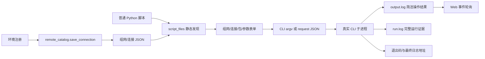

# Web 最简实现与接手说明

## 快速开始

唯一启动方式为 `python -X utf8 startWeb.py`，唯一地址为 <http://127.0.0.1:8765/>。不新增启动器、host/port 参数或备用服务；端口冲突直接失败。按钮使用方法见 [Web 快速开始](web_usage.md)。

主页面只包含两个入口：“运行脚本”和“环境注册”。用户输入转换成 `python -X utf8 -m autoenv.cli run ... --non-interactive` 参数，启动独立 CLI 子进程。Web 不直接调用设备 SDK，也不调用 `adapt_interface.py` 执行新脚本。



## 组件和接口

| 组件 | 职责 |
| --- | --- |
| `startWeb.py` | 固定入口和地址，拒绝启动参数 |
| `webPage/server.py` | HTTP、目录与脚本描述、CLI 参数转换、子进程生命周期、简洁输出事件 |
| `webPage/index.html/app.js/styles.css` | 无构建链表单、真实命令预览、操作结果、日志定位 |
| `autoenv/remote_catalog.py` | 连接类型校验、两级目录读取和原子保存 |
| `autoenv/script_files.py` | AST 读取普通脚本的环境申请、包和参数，不执行脚本 |
| `autoenv/cli.py/script_session.py` | 唯一执行语义、运行目录、完整日志、简洁逐操作事件 |

| HTTP 接口 | 输入 | 输出 |
| --- | --- | --- |
| `GET /api/environments` | 无 | `topologies: {组网: {连接名: 配置}}` |
| `POST /api/environments` | `{topology, connection}` | `{ok: true}`；配置无效时 HTTP 400 |
| `GET /api/scripts` | 无 | `{scripts: [{script,path,slots,topologies,packages,arguments,...}]}` |
| `POST /api/run/command` | `{script,selected_topology,bindings,packages,arguments}` | `{command}`；仅构造命令，不执行 |
| `POST /api/run/start` | 同上 | `{ok,generation,command}`，启动真实 CLI |
| `GET /api/run/events?cursor=N` | 已读取事件数量 | `{events,next,generation}` |
| `POST /api/run/stop` | `{}` | `{ok}`，终止本地 CLI |
| `POST /api/open` | `{target: "log"或"run"}` | `{ok}`，仅打开当前运行文件/目录 |

环境文件为 `environments/topologies/<组网>/connections.json`，顶层数组中的每项包含 `name/type/host/port` 与协议字段。SSH `upload_type=scp/sftp`；Telnet `shell_mode=auto/posix/prompt_only`、可选自检 `probe_command/probe_keyword` 和登录 `username/password/login_prompt/password_prompt`；FTP `passive`。Web 与 CLI 复用核心校验，不能另建协议或资源标签绑定规则。

脚本为 `scripts/*.py` 普通 Python 文件，包含 `main()` 或顶层流程，显式调用 `init_script()` 与直接赋值的 `get_remote_info()`。取消装饰器发现。环境候选从所有对象白名单的组网交集产生；二级候选只包含选定组网中该对象允许的类型。单个脚本无法描述时返回其 `error`，不会阻断其他脚本。

## CLI 桥接和证据

基础字段逐个转换为 CLI argv，`subprocess.Popen` 不启用 shell。复杂列表/字典生成 schema 2 请求 JSON，使用 `--request`，不同时混用绑定或参数 flags。前端展示的复制命令与实际执行 argv 相同；Windows 使用可复制的 PowerShell 单引号转义。

CLI 启动时接收内部 `--event-file <临时JSON>`，在 bootstrap 创建会话后写入 `log_path/output_path/run_dir`。Web 后台线程持续 tail `output.log`，按完整 UTF-8 行发布 `output` 事件；同时排空子进程 stdout/stderr，避免管道阻塞。结束前补读最后一批输出，再发布包含 `exit_code/success/log_path/output_path` 的 `complete` 事件。每次运行增加 generation，旧事件不进入新任务。

`output.log` 是简洁操作事件；`run.log` 保存脚本位置、命令、结果、远端输出与 Python/继承子进程输出。普通 CLI stdout 最后仅一行绝对日志地址。Web 不把 `run.log` 当作实时操作输出，不解析远端输出中的伪事件。`--event-file` 文件结束后删除；复杂参数 request 文件保留在被忽略的 `webPage/.runtime/`，使复制命令仍可运行。

退出码 `0/1/2` 分别表示流程成功、运行失败、准备失败。停止进程保留已写日志，但不把停止视为成功。连接细节依旧由原 SSH、Telnet、FTP 实现承担；Web 只负责填入参数与调用方式。

## 高级组件和边界

既有 Tools、日志 SDK 和 ConPTY 后端契约仍保留，主页面不展示这些模块。它们使用独立 `ProcessSession/TerminalSession`，不参与新脚本启动。增加独立 Tool 时仍需相应 project skill，不应重新加回复杂主页面。

服务固定监听本机，没有登录鉴权。环境密码按项目需求允许明文，运行目录、连接配置、临时请求不提交。“打开日志/目录”只接受当前任务已知路径，不接受客户端任意路径。环境名由 `remote_catalog.safe_name()` 校验；脚本路径由 `script_files.resolve_script()` 校验。

## 本地测试与接手检查

```powershell
python -X utf8 -m pytest -q tests/test_web_cli_bridge.py tests/test_interfaces_web_ftp.py
python -X utf8 -m compileall -q autoenv scripts webPage
node --check webPage/app.js
```

`test_web_cli_bridge.py` 启动真实 loopback HTTP 服务和 CLI 子进程，验证两级注册、SSH 传输字段、静态发现不执行脚本、中文与复杂参数、操作输出和日志分离、退出码与准备失败日志。原混合测试继续验证高级后端和 FTP 真实数据传输。

修改后应检查命令复制、候选过滤、CLI 非交互行为、日志来源行号和停止后的完整末尾事件。浏览器 UI 需另做桌面视觉/操作检查；离线测试不能替代真实设备、TCP 串口网关和真实 HDFS 的验收。
