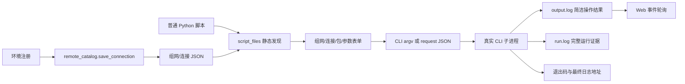

# Web 最简实现与接手说明

## 快速开始

唯一启动方式为 `python -X utf8 startWeb.py`，唯一地址为 <http://127.0.0.1:8765/>。不新增启动器、host/port 参数或备用服务；端口冲突直接失败。按钮使用方法见 [Web 快速开始](web_usage.md)。

本页负责源码 Web 的实现接手。SDK/CLI 安装范围、已测环境和高级能力归属见 [文档入口与能力边界](DOCUMENTATION_MAP.md)。源码 Web 不提供第二个 wheel 启动入口。

主页面包含“运行脚本”“环境注册”和独立产品日志页面链接。环境脚本输入转换成 `python -X utf8 -m autoenv.cli run ... --non-interactive` 参数，启动独立 CLI 子进程。Web 不直接调用设备 SDK，也不调用 `adapt_interface.py` 执行新脚本。

产品日志按用户要求独立实现于 `product_log/`：`/product-logs/` 的专属任务管理器调用 `workflow.run_analysis()`，与 `python -m product_log` 共用整理/解析逻辑。它只处理本地文件，单独管理取消事件、上传和历史批次，不复用会终止上一任务的远端脚本 ProcessSession。

核心及 CLI 保留 `auto/product/generic`，网页固定使用 product。来源、文件、解析器、组件匹配和显示映射迁移到 `product_log/default_config.json`；Python 随包读取，离线构建把同一份 JSON 内嵌到应用和 Worker。`configuration.py` 与 `standalone/configuration.js` 校验相同合同。`POST /api/product-logs/start` 接收 `analysis_config`，CLI 支持 `--config FILE`，批次 manifest 保存实际配置快照；`GET /api/product-logs/configuration` 提供初始配置。未提供显式配置的旧参数调用转换为本次配置覆盖；旧 generic 流程生成目录/文件/diag 解析器及规则明确的临时来源并进入快照。显式配置始终只按所选来源处理，空规则或无命中不触发通用规则及旧硬编码回退。

规则通过 `source_ids` 选择命名来源，来源通过 `parser_id` 绑定解析器；来源选项可多选，未引用的来源不解析，不自动切换到未选来源。初始 `diag_v1` 从同文件识别用户态/固件，`dmesg_v1` 解析内核；类别固定三类。初始 `any` 规则显式保留旧识别范围，删除或取消来源后不恢复；模块表不自动发现或补回条目。同一实际文件在相同解析配置下共享读取，配置冲突明确报错。固件先识别完整段与续行再筛选，避免提前按关键词丢失正文。

页面将配置、来源选择、可选整理和模块表集中在默认关闭的“设置”对话框，主界面保留导入、状态和浏览。设置可保存到浏览器存储及导入/下载完整 JSON；日志正文不进浏览器设置存储。解析设置只作用于下一次导入，既有批次保留原配置；模块表仍可直接查询当前索引。

准备阶段仍先用队列递归展开整个压缩包森林，包括未选中目录中的包；旧 `archive_patterns/--archive-pattern` 只校验、不限制准备。目录定位优先输入文件夹或顶层包内容中的候选，无命中再搜索嵌套包；唯一祖先可覆盖所有后代候选时自动选祖先，不同分支保持歧义而不按字符串长度任取。`directory_patterns` 的顺序表示显式不存在回退，初始 dmesg 因而优先 varlog、再试 var。包文件名不算目录组件，部分路径可跨打包边界；结构化来源信息区分包边界与字面 `!/`。选定收集根后仍按来源配置递归读取其普通目录及包内日志。通用 SDK `find_subdir()` 的严格唯一及 handler 排序合同不变；Python 本机归档后端边界见 [产品日志说明](../product_log/README.md#输出与读取规则)。

Web 管理根内的产品日志上传和批次达到 3 GiB（`3 * 1024**3` 字节）后按最旧顺序清理已结束任务与可回收上传，保护活动或仍被引用的内容。仅删除管理根内的任务产物；外部输入、独立 CLI 输出及普通脚本运行日志不纳入该策略。它是触发阈值，不是硬配额，具体保护和清理时机见 [产品日志说明](../product_log/README.md)。

单文件离线日志页由 `python -X utf8 tools/build_product_log_page.py` 生成 `dist/product-log-offline.html`，构建只使用 Python 标准库，支持 `-I -S`。它将 `product_log/standalone/` 的页面、Worker、独立 JavaScript 收集/解析/查询和本地解码器全内嵌。ZIP LZMA（算法 14）使用纯 JavaScript LZMA；RAR4/RAR5 普通及固实压缩由 node-unrar 的内嵌 WASM 解码，libarchive-WASM 在 RAR5 提取前补充链接/特殊成员元数据检查。Worker 中全部资源离线运行，无网络加载或系统解压工具依赖。vendor 保存第三方原始字节与许可，[资源清单](../product_log/standalone/vendor/manifest.json) 记录固定版本、来源与 SHA256，构建先校验摘要；[总许可说明](../product_log/standalone/THIRD_PARTY_NOTICES.txt) 随 HTML 保留。

使用者仅需现代浏览器。浏览器业务规则通过 Python 结果对照验证，构建时不导入 SDK 或启动服务；既有入口继续可用。输入经文件/目录选择进入页面内存，来源显示相对路径；解析配置和模块表均在设置中编辑，完整规则可导入/下载 JSON，可选复制/重命名操作内存副本。磁盘工作区、任意绝对路径导入、历史和 3 GiB 清理只在服务端版本提供，详见 [独立离线页说明](../product_log/standalone/README.md)。



## 组件和接口

| 组件 | 职责 |
| --- | --- |
| `startWeb.py` | 固定入口和地址，拒绝启动参数 |
| `webPage/server.py` | HTTP、目录与脚本描述、CLI 参数转换、子进程生命周期、简洁输出事件 |
| `webPage/index.html/app.js/styles.css` | 无构建链表单、真实命令预览、操作结果、日志定位 |
| `autoenv/remote_catalog.py` | 连接类型校验、两级目录读取和原子保存 |
| `autoenv/script_files.py` | AST 读取普通脚本的环境申请、包和参数，不执行脚本 |
| `autoenv/cli.py/script_session.py` | 唯一执行语义、运行目录、完整日志、简洁逐操作事件 |
| `autoenv/telnet_client.py/remote_environment.py` | 串口登录、auto 模式识别及 command/keyword/prompt 自检结果；未知命令退出码保持未知 |
| `autoenv/local_archives.py`、`autoenv/_vendor/` | 内容识别、单包解压与成员验证；固定原始 rarfile 仅解析 RAR 元数据，后端范围见产品 README |
| `product_log/workflow.py/parser.py/index.py` | 双域产品/通用收集、用户态及 dmesg 日期解析、跨文件 seg 组装、SQLite 索引和分类/统一时间查询 |
| `product_log/module_map.py` | 默认与发现模块表、用户态名称精确匹配、内核关键词大小写无关字面匹配、按批次保存及即时动态分组 |
| `product_log/web.py/static/` | 任务线程、分块上传、历史任务、模块表编辑、分页/虚拟列表、来源查看 |
| `product_log/retention.py` | 只统计/清理 Web 管理根内的上传和批次，验证清理目标并保护当前内容 |
| `tools/build_product_log_page.py`、`product_log/standalone/` | 摘要校验后用标准库构建单文件 HTML；浏览器 Worker 全量归档准备、ZIP LZMA/RAR 解码、内存解析/查询，源码与 Python/服务端静态资源独立 |

| HTTP 接口 | 输入 | 输出 |
| --- | --- | --- |
| `GET /api/environments` | 无 | `topologies: {组网: {连接名: 配置}}` |
| `POST /api/environments` | `{topology, connection}` | `{ok: true}`；配置无效时 HTTP 400 |
| `GET /api/scripts` | 无 | `{scripts: [{script,path,slots,topologies,packages,arguments,...}]}` |
| `POST /api/run/command` | `{script,selected_topology,bindings,packages,arguments}` | `{command}`；仅构造命令，不执行 |
| `POST /api/run/start` | 同上 | `{ok,generation,command}`，启动真实 CLI |
| `GET /api/run/events?cursor=N` | 已读取事件数量 | `{events,next,generation}` |
| `POST /api/run/stop` | `{}` | `{ok}`，终止本地 CLI |
| `POST /api/open` | `{target: "log"或"run"}` | `{ok}`，仅打开当前运行文件/目录 |

环境文件为 `environments/topologies/<组网>/connections.json`，顶层数组中的每项包含 `name/type/host/port` 与协议字段。SSH `upload_type=scp/sftp`；Telnet `shell_mode=auto/posix/prompt_only`、成对可选自检 `probe_command/probe_keyword` 和登录 `username/password/login_prompt/password_prompt`；FTP `passive`。Web 与 CLI 复用核心校验，不能另建协议或资源标签绑定规则。

串口登录先识别真正的登录、密码或命令提示符，适配已登录、仅用户名和密码挑战场景。`auto` 探测 POSIX 返回码能力，未获得返回码但返回有效设备提示符时按 prompt_only 处理。自检记录 `check_scope=command/keyword/prompt` 和 `exit_status_available`；提示符就绪可以 available，但普通命令的退出码仍未知，不能写成退出 0。UDK 固件流程仍严格要求退出码 0，再于正常返回后检查 success。配置、自检错误与证据字段的完整语义见 [环境登记](ENVIRONMENT_REGISTRATION_GUIDE.md)、[接口说明](SCRIPT_API_ANALYSIS.md) 和 [UDK 工作流](UDK_V100_WORKFLOWS.md)；本轮适配未验证真实硬件。

脚本为 `scripts/*.py` 普通 Python 文件，包含 `main()` 或顶层流程，显式调用 `init_script()` 与直接赋值的 `get_remote_info()`。取消装饰器发现。环境候选从所有对象白名单的组网交集产生；二级候选只包含选定组网中该对象允许的类型。单个脚本无法描述时返回其 `error`，不会阻断其他脚本。

## CLI 桥接和证据

基础字段逐个转换为 CLI argv，`subprocess.Popen` 不启用 shell。复杂列表/字典生成 schema 2 请求 JSON，使用 `--request`，不同时混用绑定或参数 flags。前端展示的复制命令与实际执行 argv 相同；Windows 使用可复制的 PowerShell 单引号转义。

CLI 启动时接收内部 `--event-file <临时JSON>`，在 bootstrap 创建会话后写入 `log_path/output_path/run_dir`。Web 后台线程持续 tail `output.log`，按完整 UTF-8 行发布 `output` 事件；同时排空子进程 stdout/stderr，避免管道阻塞。结束前补读最后一批输出，再发布包含 `exit_code/success/log_path/output_path` 的 `complete` 事件。每次运行增加 generation，旧事件不进入新任务。

`output.log` 是简洁操作事件；`run.log` 保存脚本位置、命令、结果、远端输出与 Python/继承子进程输出。普通 CLI stdout 最后仅一行绝对日志地址。Web 不把 `run.log` 当作实时操作输出，不解析远端输出中的伪事件。`--event-file` 文件结束后删除；复杂参数 request 文件保留在被忽略的 `webPage/.runtime/`，使复制命令仍可运行。

退出码 `0/1/2` 分别表示流程成功、运行失败、准备失败。停止进程保留已写日志，但不把停止视为成功。连接细节依旧由原 SSH、Telnet、FTP 实现承担；Web 只负责填入参数与调用方式。

## 高级组件和边界

既有 Tools、日志 SDK 和 ConPTY 后端契约仍保留，主页面不展示这些模块。它们使用独立 `ProcessSession/TerminalSession`，不参与新脚本启动。增加独立 Tool 时仍需相应 project skill，不应重新加回复杂主页面。

服务固定监听本机，没有登录鉴权。环境密码按项目需求允许明文，运行目录、连接配置、临时请求不提交。“打开日志/目录”只接受当前任务已知路径，不接受客户端任意路径。环境名由 `remote_catalog.safe_name()` 校验；脚本路径由 `script_files.resolve_script()` 校验。

本轮按个人本地单任务使用维护，不新增来源校验/令牌、配置并发事务或旧脚本启动停止治理。已有高级路由继续保留；其不出现在主页的事实不等于停用。评审中的事实与本轮不采纳的改造应分开看，取舍记录见 [项目评审补充](PROJECT_REVIEW_2026-10-11.md#本轮使用约束与用户取舍)。

## 本地测试与接手检查

产品日志新增 `/api/product-logs/` 命名空间，覆盖上传 create/chunk/finish、start/events/stop/batches、groups/query/source/export、`GET/POST modules` 对应表及 `GET storage` 的占用检查和自动清理。start 接收收集模式和分别指定的 diag/varlog 目录规则，既有 var_directory_pattern 字段名保留；archive_patterns 只保留请求兼容与校验；groups/query/export 支持 `driver_domain`，query/export 支持 `kind=all` 和业务表 `module`。modules 返回用户存在状态、两态数量及内核是否配置，POST 保存至批次 `module-map.json` 后即时生效。storage 可带 `batch_id` 登记当前查看批次；空值解除查看保护，返回占用、阈值、最近清理和错误。

当前产品索引 schema 为 **3**，配置合同 `version` 为 `1`，manifest 同时声明 microseconds 时间单位。segments/dumps 的 time_value 可为 NULL，支持 diag `time_format: "none"`；未知读取时间仍依据来源、流及 seg 结构拼接。索引按完全相同版本恢复和查询，schema 2 等旧批次要求重新导入。records 保存 driver_domain 与原始 ModuleName；名称归一使用批次配置的 module_aliases。无日期内核行 time_value 为 NULL，不继承日期；统一时间未知行排在有效日期之后。Slot/Cpu 条件仅筛用户态/固件，业务模块表仅筛两态驱动，固件仍按自身 Dev/logType 维度管理。

二进制上传必须在旧 JSON body 读取前分发。静态资源只映射 `product_log/static/` 中的固定文件，批次/来源通过服务端登记 ID 查找。完成的 manifest 才发布索引，部分结果不作为成功任务查询。CLI 参数和导入/分组语义见 [product_log/README.md](../product_log/README.md)。

```powershell
python -X utf8 -m pytest -q tests/test_web_cli_bridge.py tests/test_interfaces_web_ftp.py
python -X utf8 -m pytest -q tests/test_product_log_collection.py tests/test_product_log_domains.py tests/test_product_log_web.py tests/test_product_log_retention.py
python -X utf8 -m pytest -q tests/test_product_log_preparation.py tests/test_local_rar_archives.py tests/test_product_log_standalone_preparation.py tests/test_product_log_standalone_archives.py tests/test_serial_compatibility.py tests/test_serial_readiness_logging.py
python -X utf8 -m compileall -q autoenv scripts webPage product_log
node --check webPage/app.js
node --check product_log/static/app.js
```

`test_web_cli_bridge.py` 启动真实 loopback HTTP 服务和 CLI 子进程，验证两级注册、SSH 传输字段、静态发现不执行脚本、中文与复杂参数、操作输出和日志分离、退出码与准备失败日志。原混合测试继续验证高级后端和 FTP 真实数据传输。

产品日志 collection/domains 测试构造真实压缩包和多来源日志，覆盖目录消歧、双域所有权、多层 var、业务文件排序、日期/未知时间、UDK 例外、模块表和统一视图；Web 测试经真实 loopback HTTP 验证上传、查询、保存及重启恢复，retention 测试继续覆盖回收边界。演示样本生成方式和 11 文件 / 2,003 用户态 / 408 内核态 / 3,600 固件的预期值见 [产品日志测试说明](../product_log/README.md#测试)。

preparation 测试覆盖目录发现前展开完整归档森林、跨包部分路径、varlog 缺失回退和歧义失败，以及已弃用 archive_patterns 不再过滤。RAR 构造样本、生成方式与摘要见 [夹具说明](../tests/fixtures/product_log_archives/README.md)；浏览器测试执行真实内嵌解码器验证 ZIP LZMA、RAR4/RAR5 及固实压缩，本机 SDK 结果遵循产品 README 中的后端边界。serial 测试覆盖常见认证流程、自检范围、未知退出状态和固件返回后的业务检查，不访问真实串口网关。

独立页的 standalone 测试执行生成 HTML 中真实内嵌 Worker，在禁止网络的 Node 环境处理同一 6,011 条样本，并对照 Python 的分类、时间、映射和完整导出；Node 仅用于开发验证，不是使用依赖。当前内置浏览器禁止 `file://`，未以临时 HTTP 服务绕过，因此真实桌面双击及网页视觉/操作验收尚未完成。验证入口及边界见 [独立离线页说明](../product_log/standalone/README.md)。

本次兼容扩展的文件、测试结果与现场验证缺口见 [2026-10-13 功能记录](../newFeature/2026-10-13-archive-and-serial-compatibility.md)。

修改后应检查命令复制、候选过滤、CLI 非交互行为、日志来源行号和停止后的完整末尾事件。浏览器 UI 需另做桌面视觉/操作检查；离线测试不能替代真实设备、TCP 串口网关和真实 HDFS 的验收。
